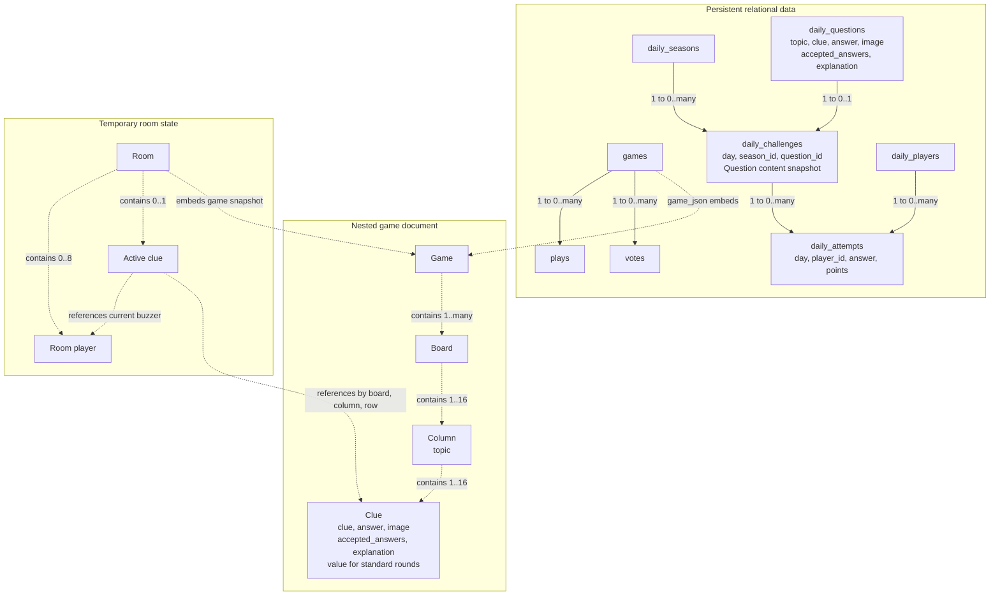

# OpenTrivia data model

Published games are stored in Cloudflare D1 as metadata and a nested `game_json` document. Games contain ordered boards; boards contain topic columns; columns contain clues. Daily trivia stores question-bank content and immutable daily challenge snapshots in relational tables.

## Shared question content

| Field | Meaning | Default |
| --- | --- | --- |
| `topic` | Category; inherited from the board column or stored on the daily question | Empty string for daily questions |
| `clue` | Text shown to players | Required; blank while authoring boards |
| `answer` | Canonical correct response | Required; blank while authoring boards |
| `accepted_answers` | Alternative correct responses, as an array of strings | `[]` |
| `explanation` | Explanation accompanying the revealed answer | Empty string |
| `image` | Optional image URL or data URL | Empty string |

D1 stores `accepted_answers` as JSON text. Board JSON stores it as an array. Board clues additionally have a derived `value` for standard rounds; boss clues use wagers and omit `value`. Daily attempts award zero or one point. Daily grading normalizes case, whitespace, and Unicode compatibility forms before comparing with the canonical answer and alternatives. Hosted and local board games retain manual judging.

Daily APIs expose only `topic`, `clue`, and `image` before submission. The correct answer and explanation are returned after that player's submission. The challenge snapshots all content fields when a question is assigned, so question-bank changes do not affect grading or presentation for an existing day.

Legacy game imports and saved games convert `answer` (displayed text) to `clue`, and `question` (correct response) to `answer`. New exports use the shared names. Migration `0003_consistent_question_content.sql` renames daily `prompt` to `clue` without changing stored text, and adds topic and image fields with empty defaults. Historical specification files describe earlier formats.

## Relationships

Solid arrows denote relational database relationships. Dotted arrows denote embedded data or runtime references.

Each vote is unique per game and voter. Each daily attempt is unique per day and daily player. Season ranges cannot overlap. Published game rating totals, weekly play counts, and daily seasonal scores are computed from their underlying records. Room players, daily players, and voters have separate identities. Rooms expire after six hours or are deleted when the host closes them.
